<div align="center">

# 🍛 Voice Order Agent

**A voice ordering system for Indian restaurants.**
Customers talk to a friendly AI waiter in **English, हिन्दी, ಕನ್ನಡ, தமிழ் or తెలుగు**,
and the kitchen gets every order on a live dashboard. Nothing is cooked until the staff confirm the payment.

[](https://github.com/Vikasmv2007/voiceAi/actions/workflows/tests.yml)


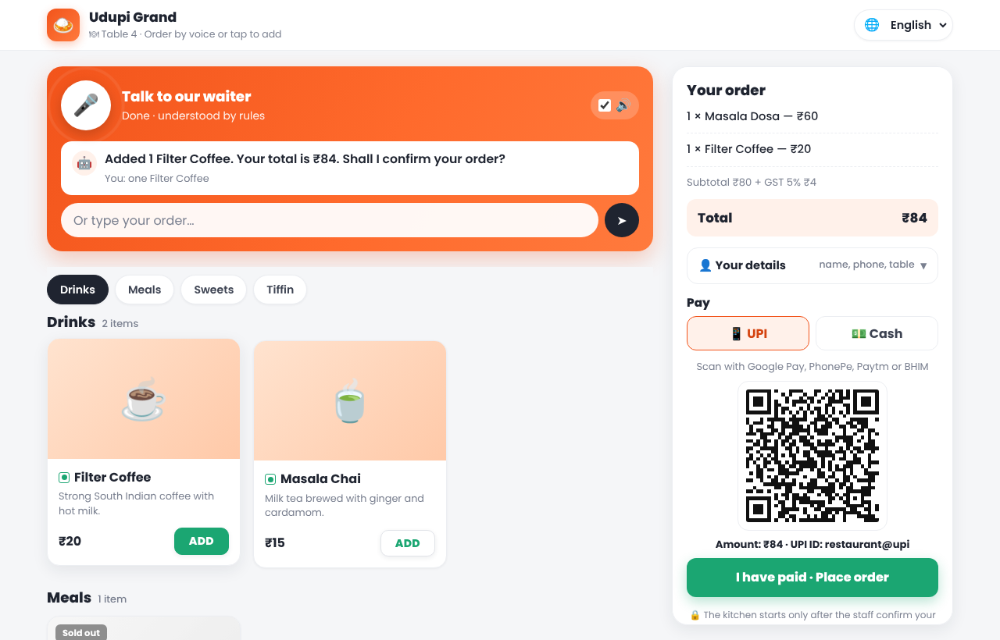&nbsp;
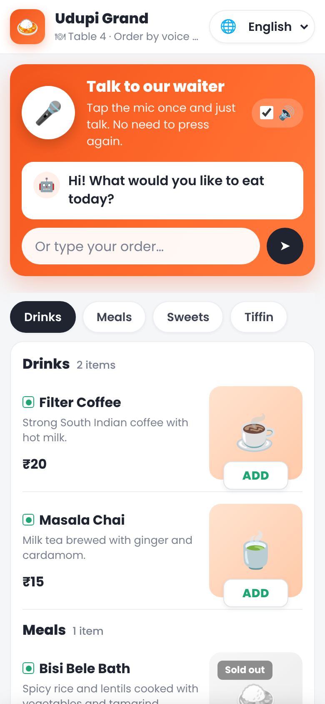

</div>

---

## Contents

- [Highlights](#highlights)
- [How an order works](#how-an-order-works)
- [Screenshots](#screenshots)
- [Quick start](#quick-start)
- [Daily use](#daily-use)
- [Settings (.env)](#settings-env)
- [Optional services](#optional-services)
- [Going live (HTTPS)](#going-live-https)
- [Project structure](#project-structure)
- [How it works inside](#how-it-works-inside)
- [Tests](#tests)
- [Useful commands](#useful-commands)
- [Troubleshooting](#troubleshooting)

---

## Highlights

<table>
<tr>
<td width="50%" valign="top">

### 🙋 For customers
- 🎙️ **Hands-free conversation**: tap the mic once and just talk. The waiter listens, replies out loud and listens again, and you can interrupt it like a real waiter.
- 🌐 **5 languages**. It switches automatically when you speak or type another language.
- 📖 **Menu with photos**. Tap **ADD** or say "two masala dosa with extra butter".
- 🍽️ **Table QR codes**: scan the code on the table and the table number is filled in.
- 💳 **UPI QR or cash**, with GST shown clearly.
- ⏱️ **Live updates**: "confirmed", "ready in about 10 minutes", "ready for table 4".
- ✖️ Cancel before payment is confirmed, ⭐ rate the order after.

</td>
<td width="50%" valign="top">

### 👨‍🍳 For staff and owners
- 🔥 **Live kitchen board** with sound and voice alerts.
- 🔐 **Staff PIN asked every time a payment is confirmed** (cash collected / UPI received).
- 🧾 **GST tax invoice** (CGST + SGST, GSTIN, invoice number) and **kitchen tickets (KOT)** for 80 mm printers.
- ✏️ **Menu editor**: dishes, photos, add-ons, descriptions, **stock counts** (dishes turn sold out by themselves).
- 📊 **Analytics**: sales, busy hours, top dishes, repeat customers, ratings.
- 👥 **Staff logins** (owner / staff), with a record of who confirmed each order.
- 📞 Phone ordering, 💬 WhatsApp / SMS updates, ⚡ Razorpay auto-confirm (all optional).

</td>
</tr>
</table>

---

## How an order works

The waiter always asks in the same order, and **only the staff (or Razorpay) can confirm an order**:

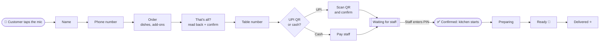

> **Why "waiting for staff"?** A customer saying "I have paid" is not proof. The order reaches the kitchen
> only after a staff member checks the cash or the UPI app and types the secret PIN. With Razorpay set up,
> UPI payments are verified and confirmed automatically.

---

## Screenshots

| Kitchen dashboard | Menu editor |
|---|---|
| 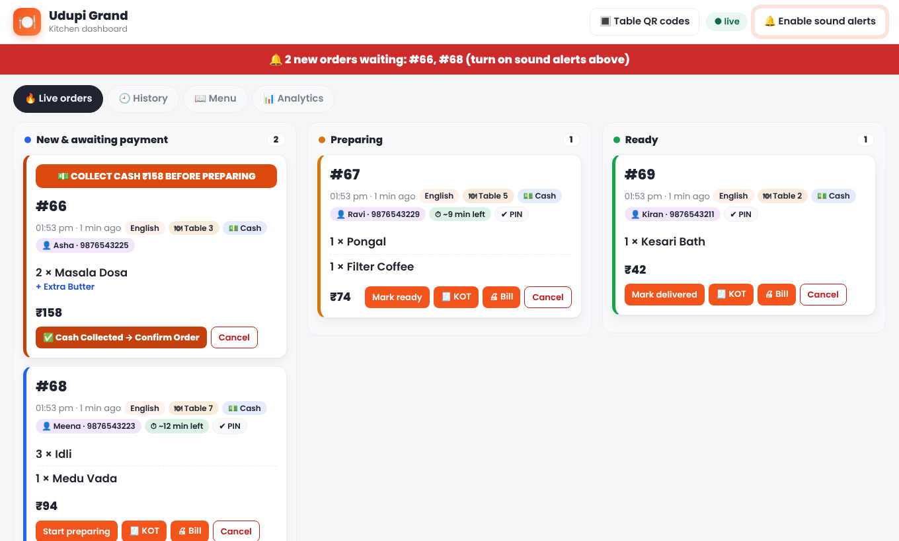 | 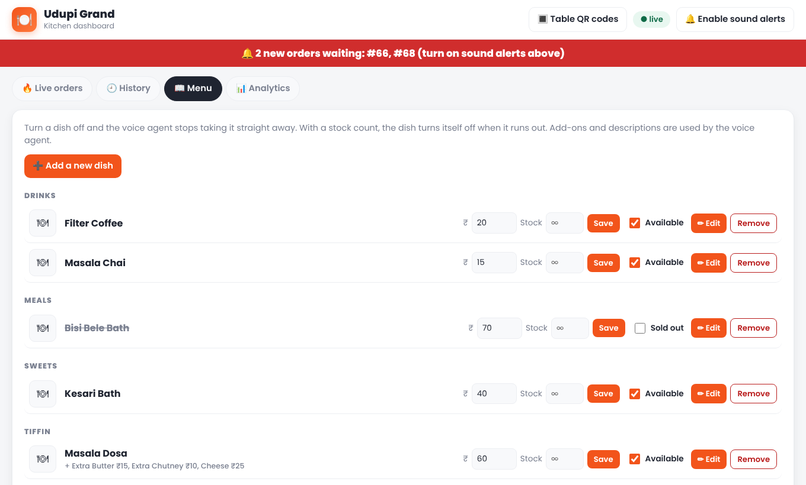 |

| Analytics | Phone: menu, cart bar, cart |
|---|---|
| 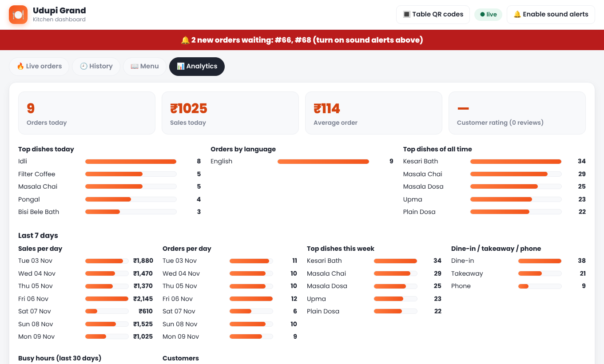 | 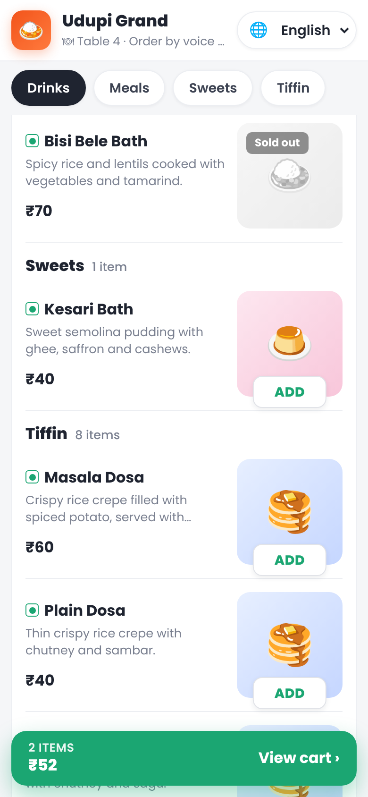 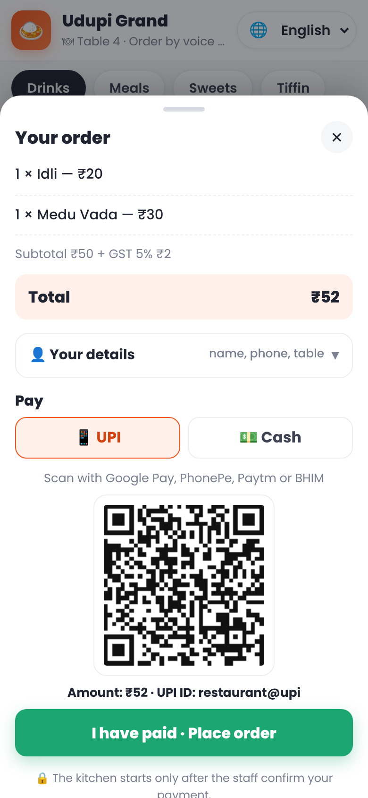 |

| GST tax invoice | Kitchen ticket (KOT) |
|---|---|
| 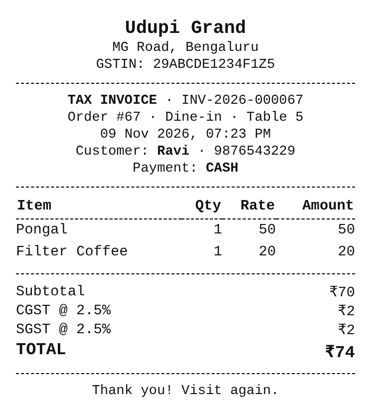 | 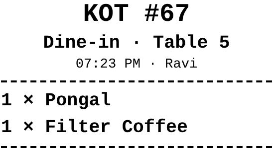 |

<sub>Screenshots use demo data (`python -m scripts.seed_demo_orders`); dishes show emoji tiles until you upload photos.</sub>

---

## Quick start

**You need:** Python 3.11+ (3.13 recommended), Git, and a [Gnani](https://gnani.ai) API key for speech.
Typing works without a key.

### 1. Get the code

```bash
git clone https://github.com/Vikasmv2007/voiceAi.git
cd voiceAi
```

### 2. Install

<details open>
<summary><b>Windows (PowerShell)</b></summary>

```powershell
python -m venv venv
venv\Scripts\activate
pip install -r requirements.txt
copy .env.example .env
```
</details>

<details>
<summary><b>macOS / Linux</b></summary>

```bash
python3 -m venv venv
source venv/bin/activate
pip install -r requirements.txt
cp .env.example .env
```
</details>

### 3. Fill in `.env`

Open `.env` and set at least these (see [all settings](#settings-env)):

```ini
GNANI_API_KEY=your-gnani-key
RESTAURANT_NAME=Udupi Grand
UPI_ID=yourshop@upi
STAFF_PIN=4321                  # your own secret number
SECRET_KEY=any-long-random-text
```

### 4. Create the database (first time only) and start

```bash
python -m app.seed_menu
python run.py
```

| Open | What it is |
|---|---|
| http://127.0.0.1:5000 | Customer ordering page (add `?table=5` for table 5) |
| http://127.0.0.1:5000/dashboard | Kitchen dashboard |
| http://127.0.0.1:5000/dashboard/tables | Printable table QR codes |

> ⚠️ `python -m app.seed_menu` creates a **fresh** database and deletes existing orders.
> Run it only once. An existing `restaurant.db` is upgraded automatically at start-up.

---

## Daily use

### Customer
1. Scan the table QR code (or open the page) and tap the 🎤 mic **once**.
2. Answer the waiter: name → phone → order → "that's all" → table → UPI or cash.
3. Pay. The page shows "waiting for staff", then "confirmed", then "ready".

### Staff
1. Keep the **dashboard** open and click **🔔 Enable sound alerts**.
2. New orders arrive under **New & awaiting payment**.
3. Collect the cash (or check your UPI app), then click **Cash Collected → Confirm Order** or **UPI Payment Received → Confirm Order**, and **type the staff PIN**. It is asked every time and never remembered.
4. Move the order along: **Start preparing → Mark ready → Mark delivered**. Print the **🧾 KOT** and **🖨 Bill** from the card.

### Owner
- **Menu tab**: add or edit dishes, upload photos, set add-ons (`Extra Cheese:20, Extra Butter:15`), stock counts and descriptions.
- **Analytics tab**: today's sales, last 7 days, busy hours, top dishes, ratings.
- **Staff logins** (optional): `python -m scripts.add_staff`. An *owner* can do everything; *staff* can't edit the menu.

---

## Settings (.env)

Copy `.env.example` to `.env`. Empty values switch a feature off.

<details>
<summary><b>Show all settings</b></summary>

| Setting | Example | What it does |
|---|---|---|
| **Basics** |||
| `GNANI_API_KEY` | `abc123` | Gnani key for speech-to-text and the waiter's voice |
| `RESTAURANT_NAME` | `Udupi Grand` | Shown on the pages and the bill |
| `RESTAURANT_ADDRESS` | `MG Road, Bengaluru` | Printed on the bill |
| `UPI_ID` / `UPI_PAYEE_NAME` | `shop@upi` | Used for the UPI QR code |
| **Security** |||
| `STAFF_PIN` | `4321` | **Required to confirm payments.** Asked every time |
| `SECRET_KEY` | long random text | Keeps staff logged in across restarts |
| `TRUST_PROXY` | `1` | Only behind nginx / Caddy / Render |
| `FLASK_DEBUG` | `0` | Never `1` on a server |
| **Bill and kitchen** |||
| `GST_RATE` | `5` | GST added on top, shown as CGST + SGST. `0` = no GST |
| `GSTIN` | `29ABCDE1234F1Z5` | Printed on the tax invoice |
| `PREP_MINUTES` / `MINUTES_PER_ORDER_AHEAD` | `10` / `3` | The "ready in about N minutes" estimate |
| **Abuse protection** |||
| `RATE_LIMIT_TURN` / `RATE_LIMIT_VOICE` | `40` / `20` | Requests per visitor per minute |
| `MAX_TEXT_CHARS` | `300` | Longest message accepted |
| **Voices** |||
| `GNANI_VOICE_TA` / `GNANI_VOICE_TE` | voice name | Tamil / Telugu voices from Gnani's catalog (text only until set) |
| **Other** |||
| `DATABASE_PATH` | `/data/restaurant.db` | Where the database is stored |

</details>

---

## Optional services

| Service | Settings | What you get |
|---|---|---|
| ⚡ **Razorpay** | `RAZORPAY_KEY_ID`, `RAZORPAY_KEY_SECRET`, `RAZORPAY_WEBHOOK_SECRET` | A one-time UPI QR for the exact amount; **UPI orders confirm automatically** when the money arrives. Phone callers get a payment link by SMS. Webhook: `https://YOUR-SITE/payments/razorpay/webhook` (events `qr_code.credited`, `payment_link.paid`) |
| 💬 **WhatsApp** | `WHATSAPP_TOKEN`, `WHATSAPP_PHONE_NUMBER_ID`, `WHATSAPP_TEMPLATE` | Messages when an order is confirmed, ready or cancelled (template with one `{{1}}` variable) |
| ✉️ **SMS** | `TWILIO_ACCOUNT_SID`, `TWILIO_AUTH_TOKEN`, `TWILIO_SMS_FROM` | The same messages by SMS, used when WhatsApp isn't set up |
| 📞 **Phone orders** | `TWILIO_ACCOUNT_SID`, `TWILIO_AUTH_TOKEN`, `PUBLIC_BASE_URL` | Customers call your Twilio number. Point its voice webhook to `/phone/incoming` |
| 🧠 **LLM helper** | `LLM_BASE_URL`, `LLM_MODEL`, `LLM_API_KEY`, `LLM_MODE` | Any OpenAI-compatible API helps with complicated sentences. Prices and checkout rules always stay in the app |

---

## Going live (HTTPS)

Phone browsers only allow the microphone on **https://** sites.

**With Docker:**

```bash
docker build -t voiceai .
docker run -d -p 8000:8000 --env-file .env -v voiceai-data:/data voiceai
```

Put **Caddy** or **nginx** in front for HTTPS and set `TRUST_PROXY=1`.

**Without Docker:**

```bash
gunicorn -w 2 --threads 4 -b 0.0.0.0:8000 run:app
```

---

## Project structure

```text
voiceAi/
├── app/
│   ├── __init__.py            # creates the Flask app
│   ├── config.py              # all settings from .env
│   ├── db.py                  # SQLite + automatic database upgrades
│   ├── schema.sql             # database tables
│   ├── seed_menu.py           # starter menu (first run)
│   ├── staff.py               # staff logins, PIN, roles
│   ├── ratelimit.py           # abuse protection
│   ├── routes/                # web pages and API
│   │   ├── voice.py           #   /api/stt, /api/turn, /api/tts
│   │   ├── orders.py          #   kitchen board, status, cancel, feedback, analytics
│   │   ├── menu.py            #   menu editor API
│   │   ├── bill.py            #   GST invoice and kitchen ticket
│   │   ├── payments.py        #   Razorpay webhook
│   │   └── phone.py           #   Twilio phone ordering
│   ├── services/              # the ordering brain and outside services
│   │   ├── order_engine.py    #   conversation and checkout rules
│   │   ├── nlu.py             #   understands what the customer said
│   │   ├── menu_matcher.py    #   finds dishes and quantities
│   │   ├── texts.py           #   every sentence, in 5 languages
│   │   ├── kitchen.py         #   status changes, stock, waiting time
│   │   ├── pricing.py         #   GST maths
│   │   ├── gnani_stt.py       #   speech-to-text (Gnani Prisma)
│   │   ├── gnani_tts.py       #   voice (Gnani Timbre)
│   │   ├── payments.py        #   Razorpay
│   │   ├── notify.py          #   WhatsApp / SMS
│   │   └── llm.py             #   optional LLM helper
│   ├── templates/             # HTML pages (customer, dashboard, bill, KOT, login, table QR)
│   └── static/                # CSS and JavaScript
├── scripts/                   # command-line helpers (see "Useful commands")
├── tests/                     # automated tests (pytest)
├── docs/screenshots/          # images used in this README
├── .github/workflows/         # runs the tests on every pull request
├── Dockerfile                 # production image
├── .env.example               # every setting, documented
├── requirements.txt           # app dependencies
├── requirements-dev.txt       # + test tools
└── run.py                     # start the app:  python run.py
```

---

## How it works inside

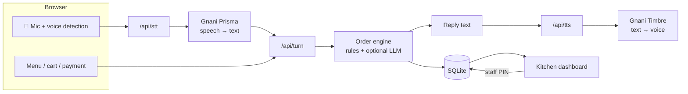

- **Understanding** is rule-based first (fast and free). An optional LLM helps only with sentences the rules can't handle.
- **Prices, stock and checkout rules** always come from the database, never from the AI.
- **Voice detection** runs in the browser: it notices when you stop talking, so you never press "stop".

---

## Tests

```bash
pip install -r requirements-dev.txt
python -m pytest
```

The tests cover ordering, all languages, add-ons, stock, GST, the order of questions, the staff PIN, logins
and roles, the kitchen flow, bills, the menu editor, rate limits and Razorpay webhooks.
[GitHub Actions](.github/workflows/tests.yml) runs them on every pull request.

---

## Useful commands

| Command | What it does |
|---|---|
| `python run.py` | Start the app |
| `python -m app.seed_menu` | **First time only**: fresh database with the starter menu |
| `python -m scripts.add_staff` | Create a staff or owner login |
| `python -m scripts.chat_cli` | Chat with the waiter in the terminal (no voice credits) |
| `python -m scripts.seed_demo_orders` | Add a week of demo orders for the analytics |
| `python -m scripts.reset_orders` | Delete all orders and keep the menu |
| `python -m scripts.check_stt file.wav hi-IN` | Test your Gnani speech-to-text key |
| `python -m scripts.check_tts` | Test your Gnani voice key (saves `hello.wav`) |
| `python -m scripts.check_llm` | Test your optional LLM settings |
| `python -m pytest` | Run the automated tests |

---

## Troubleshooting

<details>
<summary><b>The page looks old or broken after updating</b></summary>

Another copy of the app may still be running. Stop all of them and start once:

```powershell
taskkill /F /IM python.exe
python run.py
```

Then press **Ctrl+F5** in the browser. (`python run.py` refuses to start if the port is already in use.)
</details>

<details>
<summary><b>The mic doesn't work on my phone</b></summary>

Phones only allow the microphone on **https://** sites. Use the [HTTPS setup](#going-live-https).
On your computer, `http://127.0.0.1:5000` works in Chrome or Edge.
</details>

<details>
<summary><b>"Voice problem: GNANI_API_KEY is missing"</b></summary>

Add your key to `.env` (`GNANI_API_KEY=...`) and restart the app. Typed ordering works without it.
</details>

<details>
<summary><b>The dashboard won't confirm a payment</b></summary>

Set `STAFF_PIN` in `.env` and restart. Confirming a payment always asks for this PIN.
</details>

<details>
<summary><b>The waiter interrupts itself on a loud speaker</b></summary>

Lower the volume or use earphones. The browser's echo cancellation usually prevents it.
</details>

---

<div align="center">
<sub>Made for Indian restaurants · Speech by <a href="https://gnani.ai">Gnani</a> · Built with Flask</sub>
</div>
